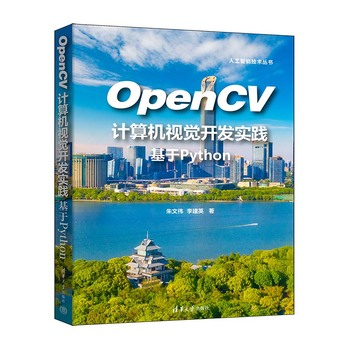

# OpenCV 计算机视觉开发实践：基于 Python

## 资源展示

{ width="280" loading="lazy" }

| 项目 | 内容 |
| --- | --- |
| 类型 | 书籍 |
| 作者 | 朱文伟、李建英 |
| 出版方 | 清华大学出版社 |
| 主题 | 计算机视觉、OpenCV、Python、数字图像处理 |

[出版社资源页](https://www.tup.com.cn/bookscenter/book_11035601.html) · [配套资料](https://www.wqyunpan.com/preview.html?id=202233&from=login)

## 内容概要

本书通过概念与代码介绍数字图像、NumPy 数组和 OpenCV 的基本使用，涉及图像读写、灰度变换、直方图、滤波、插值、几何变换与边缘检测等内容。示例以库函数调用为主，便于观察不同图像处理操作的效果。

## 资源评述

这类实践资料的主要价值，是将抽象的图像处理方法转化为可以直接观察的输入与输出。理解数据表示、参数含义与结果变化，比单独记忆函数名称更便于迁移到实际任务。

经典图像处理与深度学习可以在数据预处理、增强和结果分析中配合使用。将滤波、几何变换等操作与具体任务联系起来，能够更清楚地理解模型接收到的信息发生了哪些变化。

## 学习参考

- 将数字图像视为带有形状、数据类型和值域的数组，核对读入、处理、显示与保存的全过程。
- OpenCV 默认彩色图像读取通常使用 BGR 通道顺序，连接使用 RGB 的显示或训练流程时需显式转换。参见 [OpenCV 图像读写文档](https://docs.opencv.org/4.x/d4/da8/group__imgcodecs.html)。
- 常见图像数组采用 HWC 排列，而 PyTorch 二维卷积模型通常使用 NCHW 批次输入；转换时应区分布局、批次维与颜色通道顺序。
- 用同一张图像比较不同滤波或插值参数，观察细节、边界与噪声如何变化，并记录与任务相关的差异。

## 版本记录 {#version-history}

| 版本号 | 更新日期 | 更新概述 |
| --- | --- | --- |
| v0.1.0 | 2026-11-03 | 启用逐篇版本记录，保留现有笔记内容。 |
