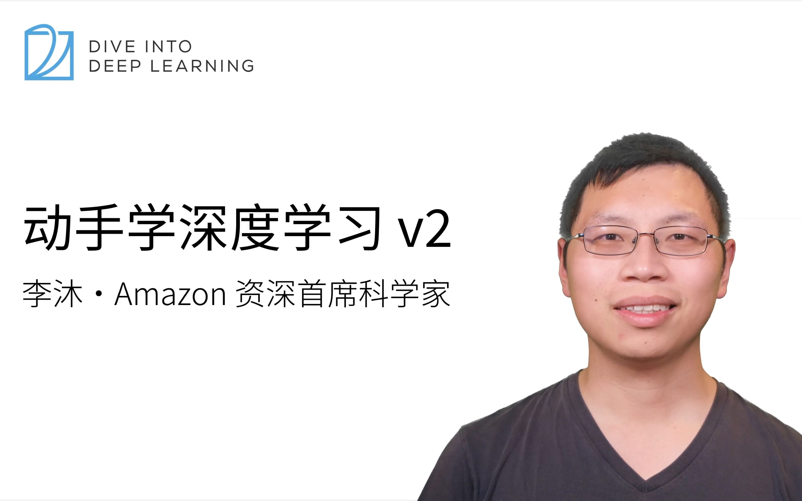

# 动手学深度学习 v2

## 资源展示

{ width="360" loading="lazy" }

| 项目 | 内容 |
| --- | --- |
| 类型 | 视频课程 |
| 主讲 | 李沐 |
| 来源 | 动手学深度学习 |
| 主题 | 深度学习、PyTorch、计算机视觉、自然语言处理 |

[课程视频](https://www.bilibili.com/video/BV1if4y147hS) · [配套在线教材](https://zh.d2l.ai/) · [教材资源页](dive-into-deep-learning.md)

## 内容概要

课程围绕《动手学深度学习》展开，通过概念讲解、代码演示与问答补充神经网络和训练实践。内容涉及卷积网络、循环网络、注意力机制以及相关任务，可以与教材按主题对照学习。

问答环节能够补充超参数设置、数据增强、实验设计等问题的讨论背景。与正文中的公式和代码结合阅读，有助于理解工程选择与理论知识之间的联系。

## 资源评述

视频适合用于补充书面材料中不易直观理解的部分，也适合在已有问题的基础上回看讲解。将教材、示例代码与问答相互对照，能够把“采用什么方法”进一步落实为“该方法解决什么问题、应观察什么现象”。

## 学习参考

- 观看前列出当前疑问，观看后用代码或教材相关章节核对解释。
- 对超参数与增强策略的讨论，记录其适用任务、数据条件和实验目的。
- 梳理从感知机、卷积网络到注意力机制的设计变化，重点关注每类结构解决的信息建模问题。
- 阅读问答中的行业讨论时保留课程所处时期的背景，结合实际任务选择可复用的方法。
