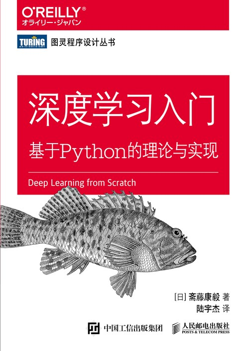

# 深度学习入门：基于 Python 的理论与实现（鱼书）

## 资源展示

{ width="280" loading="lazy" }

| 项目 | 内容 |
| --- | --- |
| 类型 | 书籍 |
| 作者 | 斋藤康毅 |
| 来源 | 人民邮电出版社 |
| 主题 | 深度学习基础、Python、NumPy、神经网络实现 |

[原书配套代码](https://github.com/oreilly-japan/deep-learning-from-scratch)

## 内容概要

本书以 Python 与 NumPy 为基础，通过实现神经网络的主要组件解释深度学习的基本原理。重点不在于调用训练框架，而在于把数学概念落实为可运行的计算过程。

内容涉及神经网络计算、损失函数、梯度与反向传播，以及参数初始化等训练设计。围绕 Xavier、He 等初始化方法和相关组件的对照实验，有助于理解常见设计选择的作用。

## 资源评述

从基础组件出发实现网络，能够使前向计算、梯度传递与参数更新之间的联系更直观。对已有框架使用经验的读者，这种实现方式也适合用于回顾训练过程中的细节。

对照实验是本书值得关注的部分：同一设计在代码中的实现方式、训练过程中的表现和相应原理可以相互印证。阅读时可把默认参数视为需要理解的设计选择，而非只记录为固定配置。

## 学习参考

- 用小数组核对形状变化和运算结果，再扩展到完整网络。
- 比较初始化方法时保持其他训练条件一致，观察梯度、损失与收敛表现。
- 将 Python 的基础语法、数据结构与 NumPy 数组操作放在实际实现中练习。
- 需要扩展到更多模型与任务时，可继续阅读[动手学深度学习](dive-into-deep-learning.md)。
