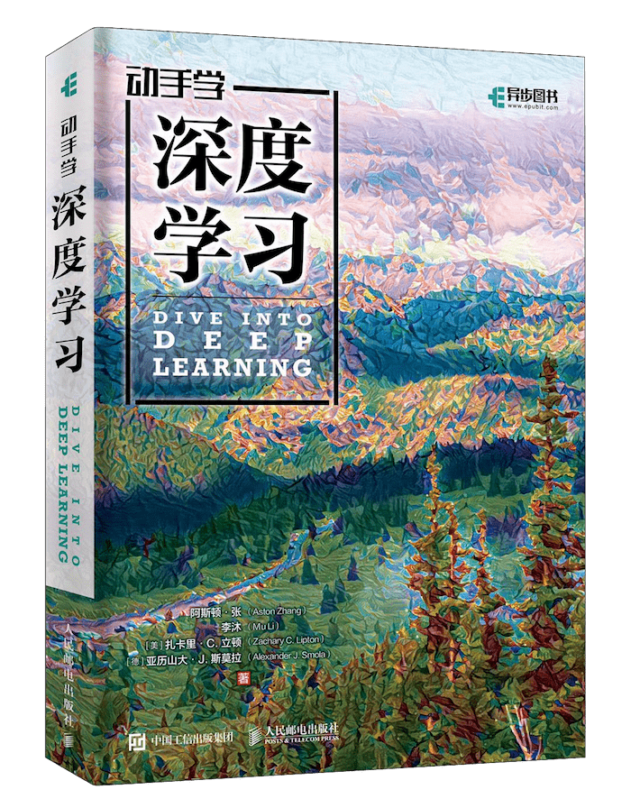

# 动手学深度学习

## 资源展示

{ width="280" loading="lazy" }

| 项目 | 内容 |
| --- | --- |
| 类型 | 书籍与在线教材 |
| 作者 | Aston Zhang、Zachary C. Lipton、Mu Li、Alexander J. Smola |
| 来源 | Dive into Deep Learning |
| 主题 | 深度学习、计算机视觉、自然语言处理 |

[中文在线教材](https://zh.d2l.ai/) · [配套视频课程](d2l-v2.md)

## 内容概要

教材将理论、代码与实验结合，从基础的数据操作和线性模型，逐步介绍多层感知机、卷积网络、循环网络与注意力机制，并延伸到视觉和自然语言处理任务。部分内容同时给出从零实现与框架简洁实现，便于对照理解原理和实际用法。

阅读中的一条重要主线是完整训练流程：数据读取与预处理、模型构建、损失计算、前向与反向传播、优化器更新，以及评估与学习率调度。理解各环节如何衔接，有助于将单个模型知识转化为可执行的实验。

## 资源评述

教材覆盖面较广，适合围绕具体章节反复查阅。初次接触时，可以先完成基础训练流程与卷积网络实践，再根据任务学习序列模型、优化算法和性能计算等内容。需要更细致地理解基础组件时，可结合[鱼书](deep-learning-from-scratch.md)补充实现过程。

## 学习参考

- 对照从零实现与框架实现，识别框架封装了哪些运算与状态管理。
- 在 Fashion-MNIST 等示例任务中修改网络时，同步核对卷积、池化与全连接层之间的张量形状。
- 比较模型改动时保持数据划分、训练轮数和评估方式一致，并记录训练曲线与结果。
- 将模型结构与任务需求对应起来，梳理卷积网络、循环网络和注意力机制各自处理的信息关系。
