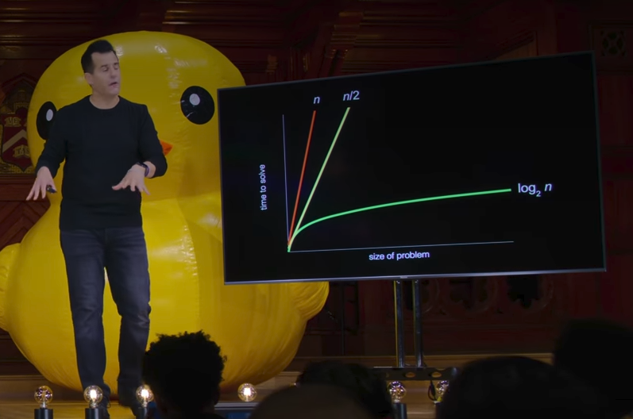

# CS50x —— 哈佛大学计算机科学入门课程

## 什么是CS50x？

CS50x 是哈佛大学推出的一门在线计算机科学入门课程，它是 CS50 课程的线上版本。该课程涵盖计算机科学的核心基础，包括算法、数据结构、软件工程和计算机网络。学生将有机会学习多种编程语言，如 C、Python 和 JavaScript，以及 SQL、CSS 和 HTML[^cs50介绍]。

CS50 之所以被许多人称为“神课”，不仅因为其高质量的教学内容，还因为其深入浅出的讲解方式，使不同背景的学习者都能轻松理解和掌握。此外，课程不仅教授计算机科学的基础知识，还强调问题解决能力和计算思维的培养[^cs50介绍]。

CS50 提供了丰富的学习资源，包括视频讲座、详细教程、作业和实践项目，为学习者带来优质的学习体验。因此，该课程在全球范围内广受好评，被誉为计算机科学入门的经典课程[^cs50介绍]。

## 相关课程资源链接

### 导航

- [课程主页（报名）](https://cs50.harvard.edu/x/)
- [教学大纲（课程介绍与作业入口）](https://cs50.harvard.edu/x/syllabus/)
- [学习入口（可进入每周的学习任务）](https://learning.edx.org/course/course-v1:HarvardX+CS50+X/home)
- [作业提交记录](https://submit.cs50.io/users/lelyetia)
- [课程成绩册](https://cs50.me/cs50x)

### Week 0 - Scratch

#### 相关链接

- [课程资料（包括视频、笔记、幻灯片等资源）](https://cs50.harvard.edu/x/weeks/0/)
- [课后习题内容](https://cs50.harvard.edu/x/psets/0/scratch/)
- [CS50鸭（一个课程助教）](https://cs50.ai/chat)
- [scratch官网](https://scratch.mit.edu/)

#### 课程内容

在第一节课程中，教授先是使用python代码构建了一个基于OpenAI软件包的**聊天机器人(chatbot)**，然后展示了硬编码与增加系统提示词观察取得的效果。这部分的视频主题为**Artificial Intelligence**。

随后开始介绍进制——计算机中使用的**二进制**与日常生活中的十进制，并由此展开**bit**与**byte**的概念。随后讲解了ASCII码表，这也说明了人类信息在计算机的二进制世界中是如何表示的，然后进行了一个小游戏。在介绍ASCII码表后紧接着就是**Unicode码表**，一个能容纳更多字符但也所需更多空间表示的码表。

接着教授讲解了**颜色**与**视频**在计算机中的表示方式。颜色由三原色RGB（红绿蓝）通过**混合**（我将其视为加权组合，0-255就是某个颜色的权重）得到；而视频则由快速变化（帧）的图像得到；有关于**音符**的表示则由3个数字组成（我对声音在计算机中的表示一无所知，还没有进行过相关的学习）。

进入下一阶段——**算法**。教授以通讯录查找联系人为例，展示了一页一页查找（n的计算复杂度）、两页两页查找（2/n复杂度），这两种方法都是基于顺序查找的前提下的，显然在此场景中不是一个很好的算法。那么**折半查找法**则能够很好的解决这个问题，它的计算复杂度为$\log_2 n$，即它较少的受到数据量增大的影响。同时需要注意，本阶段的课程讲解存在**撕书环节**（物理）！随后教授采用**伪代码**将刚刚查找通讯录联系人的折半查找法例子进行了表示，并解释了有关于代码的一些事情——例如计算机如何理解它们？

接下来进入本节课程真正意义上的第二部分：编程语言——**Scratch**。一种面向少儿编程的可视化编程语言，我在初中曾接触过它并用它完成了当时期末考试——大鱼吃小鱼。教授通过Scratch，抽象地为我们展示了一些编程语言中的常见的概念——包括如何**输出**、如何**输入**并使用**自定义变量**、如何使用**循环**避免代码重复、定义自己的**函数**、通过**条件判断语句**选择性地执行代码等。最后教授通过展示了两个由Scratch编写的小游戏并通过讲解这两个程序的**对象**、每个对象所需要扮演的角色（即每个对象所需要执行的代码）。每个游戏都邀请了志愿者游玩，课堂结束在了一片欢乐的氛围中。有关这部分内容，如果已经具备至少一门编程语言基础的学生来说应该不难理解，但“Better doing than saying”，我们很快就会在课后练习中再次接触到它。

有关于课程的详细内容，可参考官方的笔记：[Week 0笔记](https://cs50.harvard.edu/x/notes/0/)[^Week 0笔记]

#### 我的课程作业

[女巫大战蝙蝠](https://scratch.mit.edu/projects/1409793741/)

## 参考资料

[^cs50介绍]:[https://www.learncs.site/docs/curriculum-resource/cs50x](https://www.learncs.site/docs/curriculum-resource/cs50x)
[^Week 0笔记]:[https://cs50.harvard.edu/x/notes/0/](https://cs50.harvard.edu/x/notes/0/)

## 版本记录 {#version-history}

| 版本号 | 更新日期 | 更新概述 |
| --- | --- | --- |
| v0.1.0 | 2026-11-03 | 开发中 |
